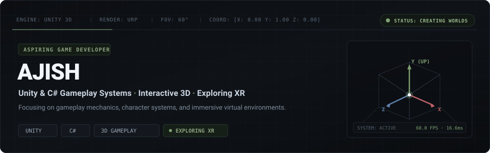
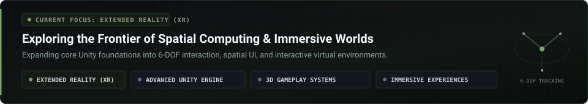
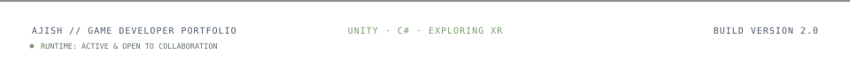

<!-- ============================================================================== -->
<!-- AJISH | ASPIRING GAME DEVELOPER — GITHUB PROFILE PORTFOLIO                     -->
<!-- Theme: Minimalist Independent Game Studio / Viewport Editorial                 -->
<!-- Palette: Deep Charcoal (#0d1117), Muted Olive (#7ea172/#8da381), Slate, White -->
<!-- ============================================================================== -->

<div align="center">

  <!-- Bespoke 3D Viewport Hero Banner -->
  

  <br />

  <!-- Animated Typing Headline -->
  <a href="https://github.com/sivaajishramr">
    
  </a>

  <!-- Quick Telemetry & Status Badges -->
  <p align="center">
    <a href="https://github.com/sivaajishramr">
      
    </a>
    <a href="https://github.com/sivaajishramr">
      
    </a>
    <a href="https://github.com/sivaajishramr">
      
    </a>
    <a href="https://komarev.com/ghpvc/?username=sivaajishramr&label=PROFILE%20VIEWS&color=253828&style=flat-square">
      
    </a>
  </p>

</div>

<p align="center">
  
</p>

## 🧭 Identity & Overview

> **"I'm a Computer Science Engineering student with a strong interest in Game Development, focused on creating interactive 3D experiences, gameplay systems, and immersive environments.**
> 
> **I enjoy bringing ideas to life through game engines, experimenting with gameplay mechanics, and understanding how games work behind the scenes.**
> 
> **Currently, I'm expanding my knowledge of Extended Reality (XR) and exploring the possibilities of immersive technologies."**

<br />

<table>
  <tr>
    <td width="50%" valign="top">
      <h3>🎮 Core Focus</h3>
      <ul>
        <li><b>Primary Focus:</b> Game Development with Unity &amp; C#.</li>
        <li><b>Gameplay Engineering:</b> Mechanics, player movement, and camera systems.</li>
        <li><b>Interactive Worlds:</b> 3D environments, animation controllers, and game UI.</li>
      </ul>
    </td>
    <td width="50%" valign="top">
      <h3>🌐 Trajectory &amp; Teamwork</h3>
      <ul>
        <li><b>Current Learning Frontier:</b> Extended Reality (XR) &amp; immersive 3D computing.</li>
        <li><b>Collaboration:</b> Proven experience contributing to team-based game development.</li>
        <li><b>Design Philosophy:</b> Passionate about turning creative ideas into playable, polished experiences.</li>
      </ul>
    </td>
  </tr>
</table>

<p align="center">
  
</p>

## 🛠️ Technical Skills &amp; Tools

<br />

#### 🎮 Game Development &amp; Systems Programming
```
┌───────────────────────────────┬────────────────────────────────────────────────────────┐
│ DOMAIN                        │ TECHNOLOGIES & CAPABILITIES                            │
├───────────────────────────────┼────────────────────────────────────────────────────────┤
│ Game Engine                   │ Unity 3D (Universal Render Pipeline / URP)             │
│ Programming Language          │ C# (Gameplay scripting, object-oriented systems)       │
│ Spatial Systems               │ 3D Game Development & World Coordinates                │
│ Player & Camera Systems       │ First/Third-person Locomotion, Kinematics, Virtual Cams │
│ Animation                     │ Animator Controllers, State Machines, Blend Trees      │
│ Gameplay Architecture         │ Interactive Mechanics, HUD/UI Bindings, Game Loops     │
└───────────────────────────────┴────────────────────────────────────────────────────────┘
```

<p>
  
  
  
  
  
  
</p>

#### 🌐 Currently Exploring
<p>
  
  
  
</p>

#### ⚙️ Development Tools &amp; Environment
<p>
  
  
  
  
</p>

<p align="center">
  
</p>

## 🕹️ Featured Game Development Projects

### 01 · Meter Chalu | Rural Driving Game



> **A rural-themed mobile driving game involving driving gameplay, passenger interactions, fares, rewards, and bargaining.**

* **Vehicle Dynamics & Controls:** Implemented core mobile driving mechanics, including throttle acceleration, responsive braking, steering, and tactile horn interactions.
* **Passenger & Economy Loop:** Engineered passenger pickup systems, ride completion validation, and dynamic gameplay concepts centered around passenger fares, rewards, and interactive bargaining.
* **Missions & Persistence:** Designed mission progression flow, player progress saving, and an intuitive mobile gameplay HUD displaying speed, passenger status, and fares.
* **Team Contribution:** Collaborated within a development team to align gameplay feel, vehicle handling, and UI responsiveness.

```yaml
Title: "Meter Chalu"
Genre: "Rural Driving Simulator & Economy"
Platform: "Mobile / Android"
Tech Stack: ["Unity 3D", "C#", "Mobile Touch Controls", "Vehicle Physics", "Economy & HUD"]
Status: "Team Contribution / Playable Build"
```

<p>
  <a href="#featured-game-development-projects">
    
  </a>
  <a href="#featured-game-development-projects">
    
  </a>
</p>

---

### 02 · Dino Merge Battle | Merge & Strategy Game



> **A dinosaur-themed game combining merge mechanics, card collection, evolution, and real-time strategy battles.**

* **Card Collection & Merge Evolution:** Designed systems to collect dinosaur cards and merge identical units to evolve combat dinosaurs into higher-tier apex species.
* **Tactical Deck Building:** Created battle deck configurations where players curate specialized dinosaur teams based on stats and synergies.
* **The DNA Lab & DinoDex:** Developed the DNA Lab mechanic for discovering new hybrid dinosaur combinations alongside a comprehensive DinoDex catalog to track species discoveries.
* **Isometric Deployment & Real-Time Combat:** Built strategic deployment grids allowing players to select spawn coordinates before triggering automated combat loops powered by unique dinosaur abilities.
* **Visual Direction:** Rendered in Unity 3D with the Universal Render Pipeline (URP), pairing stylized 3D dinosaur characters with clean isometric battle arena environments.

```yaml
Title: "Dino Merge Battle"
Genre: "Merge Evolution & Real-Time Strategy"
Perspective: "Isometric 3D Arena"
Tech Stack: ["Unity 3D", "Universal Render Pipeline (URP)", "C#", "Merge Systems", "Deck Building"]
Architecture: ["DNA Lab Combinations", "DinoDex Tracking", "Autonomous Combat AI"]
```

<p>
  <a href="#featured-game-development-projects">
    
  </a>
  <a href="#featured-game-development-projects">
    
  </a>
</p>

---

### 03 · Forgotten Cavern | Personal Game Project



> **A personal 3D game project exploring a story-driven gaming experience through environmental atmosphere and narrative design.**

* **Story-Driven Concept:** Crafting an intimate, atmospheric 3D adventure focused on exploration, environmental discovery, and narrative pacing.
* **Atmospheric Environment Design:** Sculpting subterranean caverns with stylized low-poly formations, volumetric fog, dynamic lighting, and moody acoustic ambiance.
* **Character & Interaction Exploration:** Developing third-person character locomotion, exploration mechanics, and quiet storytelling embedded directly into the terrain and ruins.

```yaml
Title: "Forgotten Cavern"
Genre: "Story-Driven 3D Atmospheric Adventure"
Platform: "PC / 3D Engine"
Tech Stack: ["Unity 3D", "C#", "Level & Environment Design", "Atmospheric Lighting", "Character Systems"]
Status: "Active Personal R&D"
```

<p>
  <a href="#featured-game-development-projects">
    
  </a>
  <a href="#featured-game-development-projects">
    
  </a>
</p>

<p align="center">
  
</p>

## 🔬 Currently Learning &amp; Research



<br />

<table>
  <tr>
    <td width="25%" align="center">
      <h4>🥽 Extended Reality (XR)</h4>
      <p>Investigating spatial UI, head/hand tracking, 6-DOF interactions, and immersive hardware paradigms.</p>
    </td>
    <td width="25%" align="center">
      <h4>🕹️ Advanced Unity</h4>
      <p>Mastering scriptable architecture, URP custom passes, memory optimization, and profiler analysis.</p>
    </td>
    <td width="25%" align="center">
      <h4>🧩 3D Gameplay Systems</h4>
      <p>Refining kinematics, physics-based movement, character controllers, and modular state machines.</p>
    </td>
    <td width="25%" align="center">
      <h4>🌌 Immersive Experiences</h4>
      <p>Studying environmental storytelling, player immersion mechanics, and interactive spatial audio.</p>
    </td>
  </tr>
</table>

<p align="center">
  
</p>

## 📊 Development Activity &amp; Statistics

<div align="center">

  <table border="0">
    <tr>
      <td width="50%" align="center">
        <a href="https://github.com/sivaajishramr">
          
        </a>
      </td>
      <td width="50%" align="center">
        <a href="https://github.com/sivaajishramr">
          
        </a>
      </td>
    </tr>
    <tr>
      <td width="50%" align="center">
        <a href="https://github.com/sivaajishramr">
          
        </a>
      </td>
      <td width="50%" align="center">
        <a href="https://github.com/sivaajishramr">
          
        </a>
      </td>
    </tr>
  </table>

</div>

<p align="center">
  
</p>

## 🤝 Let's Connect

Feel free to reach out to discuss game development, Unity architecture, XR experimentation, or collaborative opportunities:

<p align="left">
  <a href="https://github.com/sivaajishramr">
    
  </a>
  &nbsp;
  <a href="https://www.linkedin.com/in/siva-ajish-ram-181353323">
    
  </a>
  &nbsp;
  <a href="mailto:your_email@example.com">
    
  </a>
</p>

<br />

<div align="center">
  
</div>
