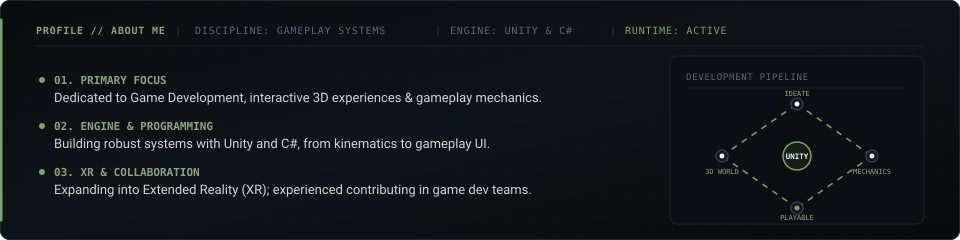

<!-- ============================================================================== -->
<!-- AJISH | ASPIRING GAME DEVELOPER — GITHUB PROFILE PORTFOLIO                     -->
<!-- Theme: Minimalist Independent Game Studio / Viewport Editorial                 -->
<!-- Palette: Deep Charcoal (#0d1117), Muted Olive (#7ea172/#8da381), Slate, White -->
<!-- ============================================================================== -->

<div align="center">

  <!-- Bespoke 3D Viewport Hero Banner with Live Engine Animations -->
  

  <br />

  <!-- Animated Typing Headline -->
  <a href="https://github.com/sivaajishramr">
    
  </a>

  <!-- Quick Telemetry & Status Badges -->
  <p align="center">
    <a href="https://github.com/sivaajishramr">
      
    </a>
    <a href="https://github.com/sivaajishramr">
      
    </a>
    <a href="https://github.com/sivaajishramr">
      
    </a>
    <a href="https://komarev.com/ghpvc/?username=sivaajishramr&label=PROFILE%20VIEWS&color=253828&style=flat-square">
      
    </a>
  </p>

</div>

<p align="center">
  
</p>

## 🧭 Identity & Overview

<!-- Animated Development Pipeline & Core Identity Card -->


<br />

> **I'm a Computer Science Engineering student with a strong interest in Game Development, focused on creating interactive 3D experiences, gameplay systems, and immersive environments.**
> 
> **I enjoy bringing ideas to life through game engines, experimenting with gameplay mechanics, and understanding how games work behind the scenes.**
> 
> **Currently, I'm expanding my knowledge of Extended Reality (XR) and exploring the possibilities of immersive technologies.**

<br />

<table>
  <tr>
    <td width="50%" valign="top">
      <h3>🎮 About Me</h3>
      <ul>
        <li>🎮 <b>Primary Focus:</b> Game Development.</li>
        <li>🕹️ <b>Engine &amp; Core:</b> Working with Unity and C#.</li>
        <li>🌐 <b>Next Frontier:</b> Currently learning Extended Reality (XR).</li>
        <li>🧩 <b>Mechanics:</b> Interested in gameplay programming, game mechanics, and interactive environments.</li>
      </ul>
    </td>
    <td width="50%" valign="top">
      <h3>🎨 Visuals &amp; Collaboration</h3>
      <ul>
        <li>🎨 <b>Aesthetics:</b> Exploring 3D environments, animation, and game UI.</li>
        <li>🤝 <b>Teamwork:</b> Have experience contributing to team-based game development.</li>
        <li>🚀 <b>Philosophy:</b> Passionate about turning creative ideas into playable experiences.</li>
      </ul>
    </td>
  </tr>
</table>

<p align="center">
  
</p>

## 🛠️ Technical Skills &amp; Tools

<!-- Animated Technical Capabilities & Architecture Matrix -->


<br />

#### 🎮 Game Development
```
┌───────────────────────────────────────┬────────────────────────────────────────────────────────┐
│ SPECIALIZATION                        │ CAPABILITIES & SYSTEMS                                 │
├───────────────────────────────────────┼────────────────────────────────────────────────────────┤
│ Engine                                │ Unity (3D Engine, URP Pipelines)                       │
│ Programming                           │ C# (Gameplay Architecture, Object-Oriented Systems)    │
│ Spatial Systems                       │ 3D Game Development & World Coordinates                │
│ Locomotion & Virtual Cameras          │ Player Movement & Camera Systems                       │
│ Character Animation                   │ Animation Controllers, Blend Trees, State Machines     │
│ Core Systems                          │ Gameplay Mechanics, Interaction Loops, HUD Bindings    │
└───────────────────────────────────────┴────────────────────────────────────────────────────────┘
```

<p>
  
  
  
  
  
  
</p>

#### 🌐 Currently Exploring
<p>
  
  
</p>

#### ⚙️ Development Tools
<p>
  
  
  
  
</p>

<p align="center">
  
</p>

## 🕹️ Featured Game Development Projects

### PROJECT 01 — Meter Chalu | Rural Driving Game

<!-- Animated Driving HUD & Rural Road Vector -->


> **A rural-themed mobile driving game involving driving gameplay, passenger interactions, fares, rewards, and bargaining.**

#### Project Details:
- 🚗 **Contributed to a rural-themed mobile driving game.**
- 🕹️ **Worked with driving controls** such as acceleration, braking, and horn interactions.
- 👥 **Explored passenger interactions** and ride completion systems.
- 💰 **Worked on gameplay concepts** involving fares, rewards, and bargaining.
- 🗺️ **Explored mission systems**, saving progress, and gameplay HUD elements.

```yaml
Title: "Meter Chalu"
Genre: "Rural Driving Game"
Platform: "Mobile"
Key Focus: ["Driving Controls", "Passenger Interactions", "Fares & Bargaining", "Mission Saves", "HUD Elements"]
Role: "Gameplay & Interaction Systems Contributor"
```

<p>
  <a href="#featured-game-development-projects">
    
  </a>
  <a href="#featured-game-development-projects">
    
  </a>
</p>

<details>
  <summary><b>📐 View Technical Architecture &amp; System Deep-Dive</b></summary>
  <br />

```
┌────────────────────────────────────────────────────────────────────────────────────────┐
│ METER CHALU // CORE GAMEPLAY ARCHITECTURE                                              │
├────────────────────────────────────────────────────────────────────────────────────────┤
│ • Vehicle Input Controller   : Mobile touch inputs mapped to acceleration & brake curves│
│ • State Machine              : Idle ➔ Passenger Pickup ➔ Transit ➔ Bargaining ➔ Complete│
│ • Economy & Bargaining Logic : Dynamic fare calculations based on distance & passenger mood│
│ • UI Event Dispatcher        : Decoupled C# Actions updating speed & fare with zero GC  │
└────────────────────────────────────────────────────────────────────────────────────────┘
```
</details>

---

### PROJECT 02 — Dino Merge Battle | Merge & Strategy Game

<!-- Animated Isometric Battlefield & Evolution Vector -->


> **A dinosaur-themed game combining merge mechanics, card collection, evolution, and real-time strategy battles.**

#### Project Concepts:
- 🧬 **Collect dinosaur cards and merge identical cards** to evolve dinosaurs.
- 🃏 **Build battle decks** using collected dinosaur cards.
- 🔬 **Discover new dinosaur combinations** through the DNA Lab.
- 📖 **Explore a DinoDex system** to track discovered dinosaurs.
- 🎯 **Strategic deployment** with player-selected cards and spawn locations.
- ⚔️ **Automatic combat** with dinosaur abilities.
- 🦖 **3D dinosaur characters** and an isometric battle arena.

#### Development Direction:
- **Engine:** Unity 3D
- **Graphics:** Universal Render Pipeline (URP)
- **Aesthetic:** Stylized 3D environments and dinosaur characters
- **Core Loops:** Merge and evolution mechanics
- **Tactics:** Card collection and battle systems

```yaml
Title: "Dino Merge Battle"
Genre: "Merge & Real-Time Strategy Game"
Perspective: "Isometric Battle Arena"
Engine: "Unity 3D (Universal Render Pipeline - URP)"
Systems: ["Dinosaur Evolution", "Battle Decks", "DNA Lab", "DinoDex Catalog", "Auto-Combat Abilities"]
```

<p>
  <a href="#featured-game-development-projects">
    
  </a>
  <a href="#featured-game-development-projects">
    
  </a>
</p>

<details>
  <summary><b>📐 View Technical Architecture &amp; System Deep-Dive</b></summary>
  <br />

```
┌────────────────────────────────────────────────────────────────────────────────────────┐
│ DINO MERGE BATTLE // CORE GAMEPLAY ARCHITECTURE                                        │
├────────────────────────────────────────────────────────────────────────────────────────┤
│ • Merge & Evolution Matrix   : Coordinate-based grid tracking identical tier evolution  │
│ • DNA Lab Combination Engine : Combinatorial registry mapping parent nodes to apex forms │
│ • DinoDex Catalog Model      : ScriptableObject database persisting discovered species  │
│ • Autonomous Combat Loop     : Target acquisition, ability cooldowns & auto-attack AI   │
│ • Render Pipeline            : Unity Universal Render Pipeline (URP) optimized for RTS │
└────────────────────────────────────────────────────────────────────────────────────────┘
```
</details>

---

### PROJECT 03 — Forgotten Cavern | Personal Game Project

<!-- Animated Subterranean Exploration & Lantern Vector -->


> **A personal 3D game project exploring a story-driven gaming experience.**

#### Project Details:
- 📖 **Exploring a story-driven 3D game concept.**
- 🌄 **Working on environment design** and atmosphere.
- 🧭 **Exploring character design**, gameplay, and storytelling.

```yaml
Title: "Forgotten Cavern"
Genre: "Story-Driven 3D Adventure"
Perspective: "Third-Person Exploration"
Key Focus: ["Environment Design", "Atmosphere & Mood", "Character Design", "Storytelling", "3D Gameplay"]
Status: "Active Personal R&D"
```

<p>
  <a href="#featured-game-development-projects">
    
  </a>
  <a href="#featured-game-development-projects">
    
  </a>
</p>

<details>
  <summary><b>📐 View Technical Architecture &amp; System Deep-Dive</b></summary>
  <br />

```
┌────────────────────────────────────────────────────────────────────────────────────────┐
│ FORGOTTEN CAVERN // CORE GAMEPLAY ARCHITECTURE                                         │
├────────────────────────────────────────────────────────────────────────────────────────┤
│ • Atmosphere & Volumetrics   : Custom fog volume attenuation & organic light falloff   │
│ • Character Controller       : Third-person kinematics with slope sliding & camera damp│
│ • Lighting & Pacing Engine   : Dynamic torch point light attenuation with flicker scripts│
│ • Narrative Flow System      : Area-triggered audio & visual environmental storytelling │
└────────────────────────────────────────────────────────────────────────────────────────┘
```
</details>

<p align="center">
  
</p>

## 🔬 Currently Learning

<!-- Animated 6-DOF Spatial Tracking & Orbiting Sensor Card -->


<br />

<table>
  <tr>
    <td width="25%" align="center">
      <h4>🥽 Extended Reality (XR)</h4>
      <p><b>Primary Learning Focus:</b> Spatial computing, 6-DOF tracking, immersive environments, and virtual interaction paradigms.</p>
    </td>
    <td width="25%" align="center">
      <h4>🕹️ Advanced Unity Development</h4>
      <p>Exploring engine internals, performance optimization, ScriptableObject architectures, and URP custom render features.</p>
    </td>
    <td width="25%" align="center">
      <h4>🧩 3D Gameplay Programming</h4>
      <p>Refining custom character controllers, dynamic kinematics, physics interactions, and modular gameplay state machines.</p>
    </td>
    <td width="25%" align="center">
      <h4>🌌 Immersive Game Experiences</h4>
      <p>Studying environmental storytelling, atmosphere creation, interactive audio spatialization, and player immersion.</p>
    </td>
  </tr>
</table>

<p align="center">
  
</p>

## 📊 GitHub Statistics

<div align="center">

  <table border="0">
    <tr>
      <td width="50%" align="center">
        <a href="https://github.com/sivaajishramr">
          
        </a>
      </td>
      <td width="50%" align="center">
        <a href="https://github.com/sivaajishramr">
          
        </a>
      </td>
    </tr>
    <tr>
      <td width="50%" align="center">
        <a href="https://github.com/sivaajishramr">
          
        </a>
      </td>
      <td width="50%" align="center">
        <a href="https://github.com/sivaajishramr">
          
        </a>
      </td>
    </tr>
  </table>

</div>

<p align="center">
  
</p>

## 🤝 Let's Connect

<!-- Animated Communication Interface & Transmission Card -->


<br />

Feel free to connect to discuss game development, Unity projects, XR experimentation, or creative collaboration:

<p align="left">
  <a href="https://ajishportfolio07.netlify.app/">
    
  </a>
  &nbsp;
  <a href="https://www.linkedin.com/in/siva-ajish-ram-181353323">
    
  </a>
  &nbsp;
  <a href="https://github.com/sivaajishramr">
    
  </a>
  &nbsp;
  <a href="mailto:your_email@example.com">
    
  </a>
</p>

<br />

<div align="center">
  <!-- Animated Studio Footer Signoff -->
  
</div>
